# Infernal Hordes War Plan tree (Season 15)

**Source:** the owner's in-game screenshots and transcription, 2026-10-23. Tooltips are verbatim. Encoded in `apps/web/src/domain/warplan.ts`.

## Structure

The activity start connects to three branches. A node can be learned once any one of its parents is learned. Pairs marked *choose one* exclude each other.

```mermaid
flowchart TD
  S((Start)) --> EC & MM & CA
  subgraph Rewards
    EC["Exalted Council"] --> CC["Council Coffers"]
    CC --> FF["Forged in Flame"] & FL["Flawless Find"] & IH["Infernal Hoard"]
    FF -.-|choose one| FL
  end
  subgraph Offers
    MM["Method and Madness"] --> RH["Reign in Hell"] & ID["Impending Doom"] & TC["Total Chaos"]
    RH --> PA["Pulse of Aether"]
    TC --> B["Bedlam"]
    PA & ID & B --> BP["The Black Pact"]
    RH -.-|choose one| TC
    PA -.-|choose one| B
  end
  subgraph Events
    CA["Cult of Annihilation"] --> ST["Scale of Tathamet"] --> DD["Devil's Deal"]
  end
```

Guides report 7 upgrade points per activity tree.

## Tooltips and how HordeMind uses them

| Node | Tooltip | HordeMind |
|---|---|---|
| Exalted Council | Bartuc and the Fell Council have +1 Monster Power and drop additional items when slain. | Rewards only; not tracked |
| Council Coffers | The Chest of Talismans will appear after defeating either the Fell Council or Bartuc. At Rank 20 with the Splinter of Terror, the Chest of Talismans now costs 1 Aether. | Rewards only |
| Forged in Flame | Obducite drops instead of Gem Fragments in the Infernal Hordes. You may only select one perk. | Rewards only |
| Flawless Find | Gem Fragments drop instead of Obducite in the Infernal Hordes. You may only select one perk. | Rewards only |
| Infernal Hoard | Defeating either the Fell Council or Bartuc reveals the Hoard of Greater Equipment, which contains a colossal deluge of equipment and other rewards. | Rewards only |
| Method and Madness | Your Infernal Offerings are more likely to share a category with your previous choice. | Changes which offers appear; recorded, not modeled |
| Reign in Hell | An additional Infernal Offering appears each wave. However, you suppress Chaos Waves from appearing. | Live Run starts with 4 offer rows |
| Total Chaos | Chaos Waves appear more frequently. However, one less Infernal Offering appears each wave. | Live Run starts with 2 offer rows |
| Impending Doom | When the current wave has 10 seconds remaining, Aether Events spawn at all locations. At Rank 14 with the Splinter of Terror, Impending Doom also triggers when the current wave has 30 seconds remaining. | **Simulated** |
| Pulse of Aether | Suppressing a Chaos Wave grants +50 Aether. All enemies in the Infernal Hordes gain +1 Monster Power. | Same for every offer; Monster Power not modeled |
| Bedlam | When you enter a Chaos Wave, gain +50 Aether and all enemies in the Infernal Hordes gain +1 Monster Power. | +50 added to the Chaotic Offering |
| The Black Pact | An ominous altar appears between waves in the Infernal Hordes. It can be invoked only once, and provides an Infernal Offering that shares a category with your previous choice. | Pact slot and advice in Live Run |
| Cult of Annihilation | Doomsayers appear during the Infernal Hordes. Doomsayers are dangerous enemies but also drop Aether. At Rank 5 with the Splinter of Terror, a Doomsayer appears at the start of each wave. | Not modeled (Aether unknown) |
| Scale of Tathamet | Once per wave the Scale of Tathamet may appear, a primordial relic that kills all enemies within the Infernal Hordes. | Not modeled |
| Devil's Deal | At the start of the Infernal Hordes, gain an Infernal Challenge. Completing the Infernal Challenge will grant +200 Aether. | Same for every offer |

Monster Power, per the in-game glossary: "Monster Power increases a Monster's Life, Damage, Experience, and Rewards."
